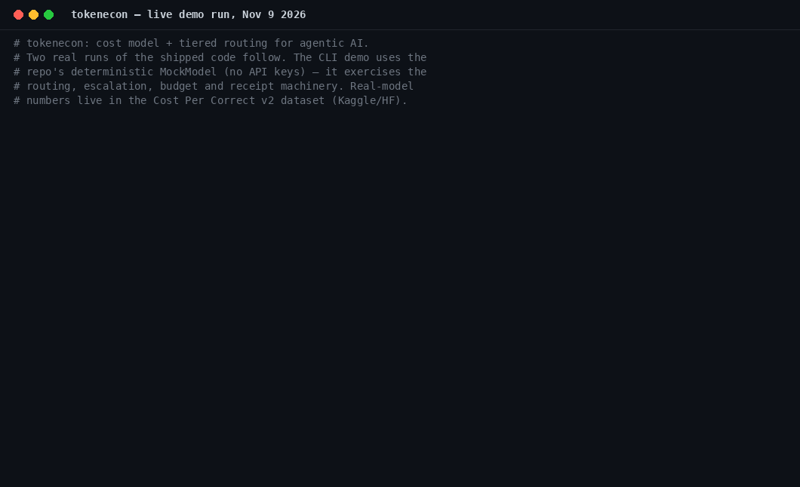

# tokenecon — Token-Economics for Agentic AI

[](https://pypi.org/project/tokenecon/)
[](https://pypi.org/project/tokenecon/)
[](https://doi.org/10.5281/zenodo.23427025)

A dependency-free Python implementation of the token-economics cost model and
tiered model routing design from the paper
[*Token-Economics for Agentic AI: A Cost Model and Tiered Routing Reference*](https://zenodo.org/records/23195511)
(K. Pandey, Oct 2026).

**The problem it solves:** a single model call has a predictable price; a looping
agent does not. Every tool call, observation, retry, and retrieved document adds
another round-trip through a priced model, and teams usually discover the total
from the cloud bill instead of the architecture. This package gives you two things:

1. **A cost model** — decompose per-task spend into prompt, completion, tool-call,
   and retrieval tokens, priced per model tier, so you can forecast and budget
   before deployment instead of reconciling after it.
2. **A tiered router** — classify each request by difficulty, send it to the
   cheapest tier capable of handling it, escalate on low confidence, and enforce
   per-task budgets that degrade gracefully instead of failing.

## Demo



*A live run of the shipped code (Nov 9, 2026): five sample tasks through the tiered router — router total $0.029307 vs $0.047454 all-large (61.76% of baseline) — then a cost-per-correct badge priced from the run's own receipts: $0.005861 per solved task. The demo uses the repo's deterministic MockModel (no API keys); it exercises the routing and receipt machinery. Full outputs are in [`demo/`](demo/).*

## Works with

- **[Argus](https://github.com/karmendra8386/argus)** — the gateway: in Argus Chat, the integrated showcase, every answer that passes through Argus ships with a tokenecon receipt under it (tier, tokens, cost) — the receipt in this demo is the same object, produced live.
- **[agent-cost-mcp-server](https://github.com/karmendra8386/agent-cost-mcp-server)** — this cost model exposed as MCP tools, so an agent can price a run, compare models by cost per successful task, and check its budget from inside its own tooling.
- **[Cost Per Prompt](https://github.com/karmendra8386/cost-per-prompt)** — the browser face of the same pricing: live token/cost estimates inside ChatGPT, Claude and Gemini, with session export as Cost Per Correct JSON.
- **The benchmarks** — cost per correct is only as honest as the "correct" underneath it: [Argus-Bench](https://doi.org/10.5281/zenodo.23877366) (gateway defences vs prompt injection) and [PersistAIBench](https://github.com/karmendra8386/persistbench-bench) (memory truthfulness over long tasks) are the suite's measures of it.

**The connected set** — one thread through all of it: what an agent did, what it cost, and whether it should have been allowed. [Argus](https://github.com/karmendra8386/argus) · [tokenecon](https://github.com/karmendra8386/agentic-ai-token-economics) · [mcplens](https://github.com/karmendra8386/mcplens) · [agent-cost-mcp-server](https://github.com/karmendra8386/agent-cost-mcp-server) · [Argus Lens](https://github.com/karmendra8386/argus-lens) · [PersistAIBench](https://github.com/karmendra8386/persistbench-bench) · [Argus-Bench](https://doi.org/10.5281/zenodo.23877366)

## Install

```bash
pip install tokenecon
```

No dependencies. Python 3.9+.

From source: `git clone https://github.com/karmendra8386/agentic-ai-token-economics.git && cd agentic-ai-token-economics && pip install .`

## Quickstart

```python
from tokenecon import TieredRouter, DEFAULT_TIERS, MockModel

router = TieredRouter(tiers=list(DEFAULT_TIERS), budget=0.05)  # 5¢ per task
receipt = router.run("Summarize our Q3 cloud spend in two sentences.", MockModel())
print(receipt.pretty())
# request    : Summarize our Q3 cloud spend in two sentences.
# difficulty : 0.17
# outcome    : ok
#   step 1: tier=small in=211 out=120 cost=$0.000138 conf=0.46
#   step 2: tier=medium in=911 out=220 cost=$0.001791 conf=0.76
# total_cost : $0.001929
```

Every run produces a **receipt**: tier used, tokens, cost, and confidence per step.
Receipts are the unit of cost observability — accumulate them and they become the
dataset your routing policy improves from.

## Track a real Strands agent

The router above forecasts cost. To measure a live agent, point the
`CostTracker` at any [Strands](https://github.com/strands-agents/harness-sdk)
agent — each event-loop cycle becomes a priced receipt step, using the token
counts the provider already reported (no estimation, no heuristics):

```python
from tokenecon.integrations.strands import CostTracker

tracker = CostTracker(tier="medium")  # or pass a tokenecon.ModelTier
agent("Summarize our Q3 cloud spend.")
print(tracker.receipt(agent, "Summarize our Q3 cloud spend.").pretty())
# request    : Summarize our Q3 cloud spend.
# difficulty : 0.163
# outcome    : ok
#   step 1: tier=medium in=1840 out=312 cost=$0.003088 conf=1.00 event-loop cycle 1
#   step 2: tier=medium in=2210 out=148 cost=$0.002802 conf=1.00 event-loop cycle 2
# total_cost : $0.005890
```

The integration is optional and dependency-free: it only reads the agent's
`event_loop_metrics`, so `strands-agents` is never imported by tokenecon itself.

## Integrations

The same `CostTracker` API — `steps`, `total_cost`, `receipt(request)`,
`reset()` — is available for the other stacks agents run on. Each integration
prices the token counts the framework already reports, and each imports its
framework lazily: tokenecon itself stays dependency-free.

**LiteLLM** — register the tracker as a callback and every successful call
is priced:

```python
import litellm
from tokenecon.integrations.litellm import CostTracker

tracker = CostTracker(tier="medium")
litellm.callbacks = [tracker]
```

**LangChain / LangGraph** — pass the tracker as a callback handler, on the
model or in the graph's invoke config:

```python
from tokenecon.integrations.langchain import CostTracker

tracker = CostTracker(tier="medium")
llm = ChatOpenAI(model="gpt-4o-mini", callbacks=[tracker])
# or: graph.invoke(inputs, config={"callbacks": [tracker]})
```

## Badge


Any run can render its own cost-per-correct badge with
`python -m tokenecon.badge results.json` — see [docs/badge.md](docs/badge.md).

## CLI

```bash
# Run 5 sample tasks through the router and compare against the all-large baseline
tokenecon demo

# Same, under a 1¢ per-task budget (watch guardrails kick in)
tokenecon demo --budget 0.01

# Forecast spend for a list of requests (one per line, no model calls)
tokenecon estimate requests.txt

# Bring your own tiers (JSON: {"tiers": [{"name": ..., "input_per_mtok": ...,
#   "output_per_mtok": ..., "capability": ...}]})
tokenecon demo --tiers my-tiers.json
```

## How the router works

1. **Classify** — each request gets a difficulty score (0–1) from surface signals:
   length, analytical keywords ("compare", "design", "prove"), question marks,
   multi-step phrasing. Simple and replaceable; graduate to a learned classifier
   with labeled traffic.
2. **Select** — cheapest tier whose capability clears difficulty + safety margin.
   Falls back to the strongest tier; the router never refuses work.
3. **Escalate** — every response carries a confidence signal; below the quality
   threshold, the request cascades to the next tier (try cheap, escalate on doubt).
4. **Budget** — two guardrails, both degrade instead of failing:
   - *Before spending:* if the cheapest first step exceeds the budget, serve a
     cached answer for $0.
   - *Before escalating:* if the next tier up would break the budget, keep the
     current answer and mark the run degraded.

The tiering arithmetic: with planning fraction α ≈ 0.1 and price ratio r ≈ 30
between tiers, tiered cost is roughly 13% of the all-strong baseline —
`tokenecon.tiering_ratio(0.1, 30)`.

## Honest limitations

- **Pricing is illustrative.** Default tiers are placeholders. Substitute your
  provider's actual price list before making decisions.
- **Token counting is heuristic** (~4 chars/token for English). Production use
  needs the provider's tokenizer or usage API.
- **Confidence comes from the mock model** in demos. Production needs a real
  signal: log-probabilities, a verifier model, or sampling agreement.
- **Single-request scope.** Multi-turn compounding (tool-call overhead, retrieval
  accumulation) is modeled in the cost equations but not executed by the router.
- See the paper (§6) for the full limitations discussion.

## Cite

If you use this software in your work, please cite the software itself — and,
for the cost model and methods behind it, the companion preprint.

**Software**

```bibtex
@software{pandey_tokenecon_2026,
  author = {Pandey, Karmendra},
  title = {tokenecon},
  version = {0.2.3},
  doi = {10.5281/zenodo.23427025},
  url = {https://github.com/karmendra8386/agentic-ai-token-economics},
  date = {2026-10-28}
}
```

**Companion preprint**

> K. Pandey, "Token-Economics for Agentic AI: A Cost Model and Tiered Routing
> Reference," Zenodo, DOI [10.5281/zenodo.23195511](https://zenodo.org/records/23195511), Oct. 2026.

```bibtex
@misc{pandey_tokeneconomics_2026,
  author = {Pandey, Karmendra},
  title = {Token-Economics for Agentic AI: A Cost Model and Tiered Routing Reference},
  doi = {10.5281/zenodo.23195511},
  url = {https://zenodo.org/records/23195511},
  publisher = {Zenodo},
  date = {2026-10}
}
```

A `CITATION.cff` is included for automated citation tooling.
Write-up: [Every Agent Run Should Come With a Receipt](https://builder.aws.com/content/3KexbQmMtjr4M9sB12oke2knKeL/every-agent-run-should-come-with-a-receipt) — AWS Builder Center

## License

MIT — see [LICENSE](LICENSE).
